

  






<table>
  <tr>
    <td width="50%"></td>
    <td width="50%"><a href="https://github.com/100dirhams/sfeerlicht"></a></td>
  </tr>
  <tr>
    <td width="50%"><a href="https://github.com/100dirhams/planner-data"></a></td>
    <td width="50%"><a href="https://github.com/100dirhams/tasks-json-server"></a></td>
  </tr>
</table>


  
  


